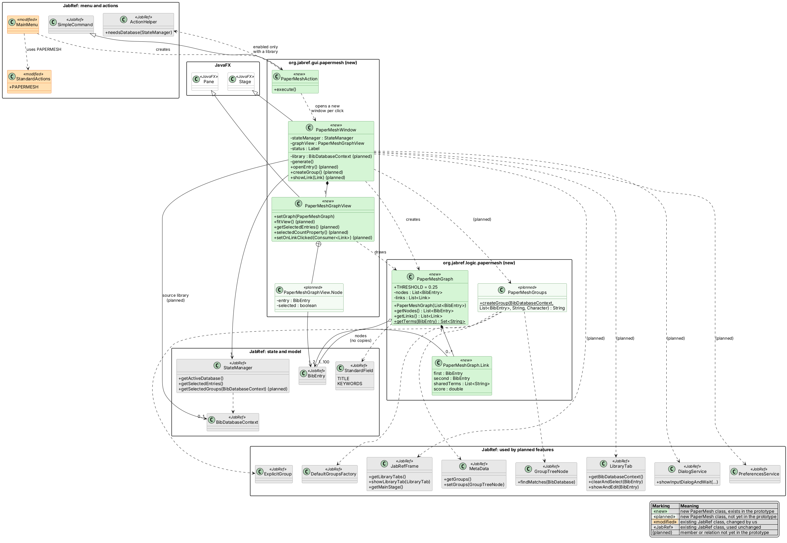
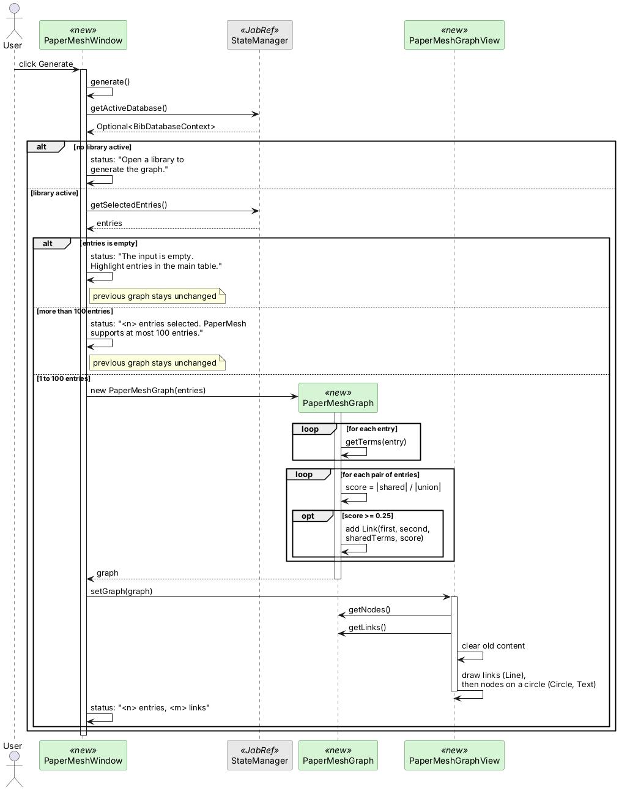
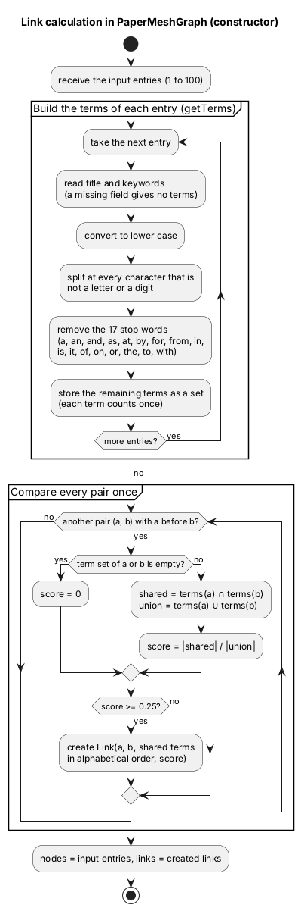
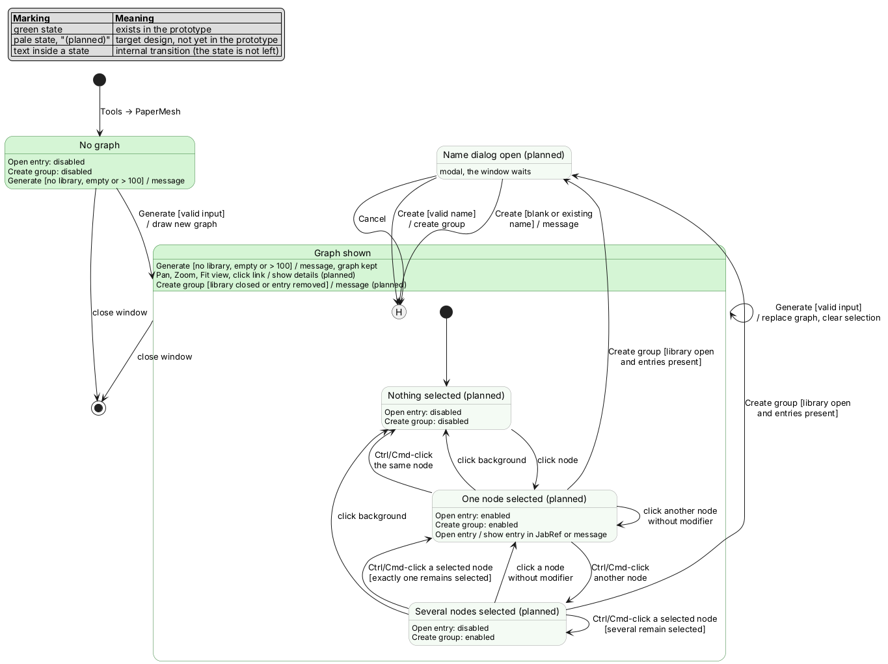

# Technical Documentation

| Version | Project name | Authors | Status | Date | Comment |
| ------- | ------------ | ------- | ------ | ---- | ------- |
| 0.1 | PaperMesh | Cian Boeniger, Dehlen Thavarajah, Gian Ledergeber, Hrishi Budema | in progress | 30.10.2026 | First draft, aligned with prototype commit `ae0c0f26b7` |

# 1 Introduction

## 1.1 Purpose

This document describes how we build PaperMesh: the structure of its classes, its most important flows and the rules that always hold in the system. It is based on the Pflichtenheft and on the first prototype. The Pflichtenheft defines *what* PaperMesh does; this document describes *how* we implement it.

It is written for our team, who use it as a reference during implementation, and for Giovanni, who reviews whether our solution fits the requirements.

The document describes the **target design**. Section 5.4 states which parts already exist in the prototype. In the class and state diagrams, everything that is not yet implemented is marked as *planned*.

## 1.2 Relation to other documents

- [Pflichtenheft](https://github.com/LenThava/PaperMesh/blob/requirements/docs/sweng/pflichtenheft.md), revision of 27 October 2026. It is on the `requirements` branch until [PR #1](https://github.com/LenThava/PaperMesh/pull/1) is merged. Requirements (/F10/ to /F61/), use cases (UC1 to UC5) and acceptance tests (/A10/ to /A61/) are referenced here by the same numbers.
- [Project plan](projektplan.md)
- Course material: [template](https://raw.githubusercontent.com/PatrickSchniderUnibas/software-engineering/main/docs/project/templates/technical-doc.md) and [course page](https://patrickschniderunibas.github.io/software-engineering/project/technical-doc)
- Prototype: private fork `Gian8732z/jabref_hs26`, branch `papermesh-prototype`, commit `ae0c0f26b7`. Its base is `0b077b315c`, which is the course baseline `c705647a4e` plus two commits from exercise 2 that do not touch PaperMesh. The source code is not part of this public repository (Pflichtenheft 2.4).

> **Note:** Pflichtenheft 2.4 still names `LenThava/jabref_hs26` as the code repository. The prototype is in `Gian8732z/jabref_hs26` because the team fork is not yet accessible to all members. The team will decide which repository applies and update the Pflichtenheft or move the code.

# 2 System overview

PaperMesh is an extension for JabRef (Java 21, JavaFX). **Tools → PaperMesh** opens a separate, non-modal window. It shows the chosen entries of a library as a graph: one node per entry, and a link between two entries whose title and keyword terms are similar. Clicking a link explains it with the shared terms and a score. From the graph, the user can jump to an entry in JabRef or create a new JabRef group from the selected nodes. PaperMesh needs no external API and copies no data; it works directly with the entries of the open library.

# 3 Design goals

- **Small changes to JabRef:** Existing JabRef files are changed only where PaperMesh has to be hooked in. In the prototype these are two files, `StandardActions` and `MainMenu`. In the target design, `JabRef_en.properties` will be added for translatable texts. Everything else lives in new packages.
- **Logic separated from the user interface:** The similarity calculation is in `org.jabref.logic.papermesh`, without JavaFX, so it can be tested with unit tests. Group creation (`PaperMeshGroups`) will go into the same package. This follows JabRef's layers gui → logic → model.
- **Bibliographic data is read only** (/F50/): Only *Create group* writes, and only group information.
- **Explainability** (/F22/): Every link can be traced back to its shared terms and a score.
- **Reuse JabRef mechanisms:** Reading the selection through `StateManager` (prototype), and in the target design navigation through `LibraryTab` and groups through `MetaData` and `GroupTreeNode`.
- **Simplicity before performance:** The input is limited to 100 entries (/F13/), and every pair is compared directly (at most 4950 pairs).
- **Exchangeable layout:** The layout (a circle in the prototype) can be replaced without touching the logic or the JabRef integration.

# 4 System behaviour

This summary of the use cases should be enough to understand the diagrams in section 5. The details are in the Pflichtenheft, Appendix A.

| Use case | Summary | Requirements |
| -------- | ------- | ------------ |
| UC1 Generate and explore a graph | The user chooses the input (highlighted entries or a selected group) and clicks *Generate*. The graph has one node per entry. Empty input or more than 100 entries gives a message, and the previous graph stays. The user can pan, zoom and use *Fit view*. | /F10/–/F13/, /F60/ |
| UC2 Inspect a link | Clicking a link shows both entries, their shared terms in alphabetical order and the score with two decimal places. | /F20/–/F22/ |
| UC3 Open an entry | With exactly one node selected, *Open entry* activates the source library, selects the entry in the main table and opens its entry editor. If the library or the entry is gone, a message is shown instead. | /F30/, /F31/ |
| UC4 Create a group | With at least one node selected, *Create group* asks for a name and creates a new static group at the root of the source library with exactly these entries. Blank or existing names are rejected. | /F40/–/F42/ |
| UC5 Search the graph (SHOULD) | Optional; not part of the current design work. | /F61/ |

# 5 Design

As the template asks, we distinguish between statics, dynamics and logic. A split into high-level, mid-level and detailed design is not needed for this extension.

## 5.1 Statics

The class diagram shows the new PaperMesh classes and the existing JabRef classes they use:

- **green, «new»:** new class that exists in the prototype
- **pale green, «planned»:** new class that is not yet in the prototype
- **orange, «modified»:** existing JabRef class that we change
- **grey, «JabRef»:** existing JabRef class used without changes

Members and relations marked *(planned)* are part of the target design but not yet in the prototype. The JabRef classes are grouped by whether the prototype already uses them. Only the methods we use are shown for them.



PlantUML source: [diagrams/class-diagram.puml](diagrams/class-diagram.puml)

### New classes

| Class | Package | Responsibility | Status |
| ----- | ------- | -------------- | ------ |
| `PaperMeshAction` (extends `SimpleCommand`) | `gui.papermesh` | Command behind *Tools → PaperMesh*. Enabled only when a library is open (`ActionHelper.needsDatabase`). `execute()` opens a new `PaperMeshWindow`. | prototype |
| `PaperMeshWindow` (extends `Stage`) | `gui.papermesh` | The window. In the prototype a `BorderPane` (900 × 600) with the *Generate* button at the top, the graph in the centre and a status line at the bottom. `generate()` reads the selection, checks it and creates the graph. In the target design it also remembers the source library and handles *Open entry*, *Create group* and the link details. | prototype, partly planned |
| `PaperMeshGraphView` (extends `Pane`) | `gui.papermesh` | Draws the graph with JavaFX `Line`, `Circle` and `Text`. It receives the graph as a parameter of `setGraph` and does not keep it. In the target design it also handles pan, zoom, *Fit view* and node selection, using an inner class `Node` that links a circle to its `BibEntry`. | prototype, partly planned |
| `PaperMeshGraph` | `logic.papermesh` | Graph model and similarity rule. The constructor computes the links from the input entries; `getTerms(BibEntry)` builds the terms of one entry. It contains the threshold 0.25 and the stop-word list. | prototype |
| `PaperMeshGraph.Link` (record) | `logic.papermesh` | One link between two entries, with their shared terms and the score. | prototype |
| `PaperMeshGroups` | `logic.papermesh` | Checks the group name and creates the static group. Returns an error message or `null`. | planned |

### JabRef classes used

| Class | Package | What PaperMesh needs it for | Status |
| ----- | ------- | --------------------------- | ------ |
| `StandardActions` (**modified**) | `gui.actions` | New constant `PAPERMESH` with the menu text "PaperMesh" | prototype |
| `MainMenu` (**modified**) | `gui.frame` | Adds the item to the Tools menu and creates `PaperMeshAction` | prototype |
| `SimpleCommand`, `ActionHelper` | `gui.actions` | Base class of the command; condition "library open" | prototype |
| `StateManager` | `gui` | `getActiveDatabase()` and `getSelectedEntries()`; in the target design also `getSelectedGroups(...)` for group input | prototype, partly planned |
| `BibDatabaseContext` | `model.database` | The library; in the prototype only obtained through `getActiveDatabase()` | prototype |
| `BibEntry`, `StandardField` | `model.entry` | Citation key, title (`TITLE`) and keywords (`KEYWORDS`) | prototype |
| `JabRefFrame` | `gui.frame` | Find and show the library tab, bring the main window to the front | planned |
| `LibraryTab` | `gui` | Select an entry in the main table and open its editor | planned |
| `DialogService` | `gui` | Input dialog for the group name | planned |
| `PreferencesService` | `preferences` | Keyword separator for static groups | planned |
| `MetaData`, `GroupTreeNode`, `ExplicitGroup` | `model.metadata`, `model.groups` | Read group members (`findMatches`), read and set the group tree, create a static group | planned |
| `DefaultGroupsFactory` | `logic.groups` | Root group "All entries" if the library has no groups yet | planned |
| `Localization`, `ThemeManager` | `logic.l10n`, `gui.theme` | Translatable texts and the JabRef style in the window | planned |

### How the classes work together

`MainMenu` creates the `PaperMeshAction`, which opens a new `PaperMeshWindow` on every click. The window contains exactly one `PaperMeshGraphView`. When the user clicks *Generate*, the window reads the highlighted entries through the `StateManager`, creates a `PaperMeshGraph` from them and passes it to the view, which draws it. The nodes of the graph are the `BibEntry` objects themselves, not copies, so in the target design an entry can be found again unambiguously for *Open entry* and *Create group*.

## 5.2 Dynamics

Each diagram shows one aspect of the system:

- **Sequence diagram:** what happens when the user clicks *Generate*. This flow is implemented in the prototype.
- **Activity diagram:** how `PaperMeshGraph` calculates the links. This is implemented in the prototype.
- **State diagram:** the states of the PaperMesh window in the target design. The parts that are not yet in the prototype are marked.

If a diagram and the Pflichtenheft disagree, the Pflichtenheft applies.

### Sequence diagram: Generate (/F12/, /F13/, /F21/)



PlantUML source: [diagrams/sequence-generate.puml](diagrams/sequence-generate.puml)

The checks happen before the graph is created, so a rejected input never replaces the previous graph. In the prototype, the input is always the highlighted entries of the main table. In the target design, `generate()` will first read the input selector and, for group input, take all members of the selected group (/F11/). It will also remember the active library as the source library and clear the node selection.

### Activity diagram: link calculation (/F20/, /F21/)



PlantUML source: [diagrams/activity-similarity.puml](diagrams/activity-similarity.puml)

An entry without usable terms gets a score of 0 with every other entry, so it stays a node without links (/F50/). Example from the test library: pmA ("Graph search", "networks") and pmB ("Graph search", "mapping") share 2 of 4 different terms, which gives 0.50 and a link (/A20/).

### State diagram: PaperMesh window (/F60.4/–/F60.8/)



PlantUML source: [diagrams/state-window.puml](diagrams/state-window.puml)

The prototype implements only the green part: *No graph*, *Graph shown*, the invalid Generate cases with their message, and closing the window. There is no node selection yet, so *Graph shown* has no substates in the prototype, and there is no *Close* button; the window is closed through the window frame.

In the target design, *Create group* opens the name dialog only if the source library is still open and all selected entries still exist (/F42/). After the dialog, the window returns to the previous selection state (history state `H`).

## 5.3 Logic

These rules always hold, even where they do not follow directly from the diagrams. Rules marked *(target design)* are not yet relevant in the prototype because the feature is missing.

1. **Input size.** Between 1 and 100 entries are allowed. Otherwise the previous graph stays unchanged and nothing is cut off (/F13/).
2. **One node per entry** *(target design)*. The input contains no entry twice, even if it is a member of several selected groups (/F12/).
3. **Terms.** Only title and keywords are used: lower case, split at every character that is not a letter or a digit, without the 17 stop words, as a set in which each term counts once. Missing fields contribute no terms (/F20/, /F21/).
4. **Link rule.** There is a link between a and b if and only if |shared terms| / |union| ≥ 0.25. If one of the sets is empty, the score is 0, so there is no link (/F21/).
5. **Shape of links.** At most one link per pair, no link from an entry to itself, a score between 0.25 and 1, and shared terms in alphabetical order.
6. **Entries without terms** stay visible as nodes without links (/F50/).
7. **Read only.** Generate, exploring the graph and *Open entry* change no data. *Create group* *(target design)* changes only the group structure and, for the selected entries, the field `groups`, because JabRef stores membership in static groups there (/F50/).
8. **Source library** *(target design)*. The graph belongs to the library that was active at the last successful Generate. *Open entry* and *Create group* act only on it, even if another library has become active (/F30/, /F40/).
9. **Identity of entries** *(target design)*. An entry is found again through its object, not through its title or field content. If the library or the entry is gone, a message is shown instead of opening another entry (/F31/).
10. **Buttons** *(target design)*. *Open entry* is enabled for exactly one selected node, *Create group* for at least one (/F60.7/, /F60.8/).
11. **Group name** *(target design)*. The name is trimmed. It must not be blank and must not exist yet in this library, ignoring case. Otherwise nothing is changed and no partial group is created (/F41/).
12. **Snapshot.** Changes in JabRef appear only after a new Generate.

The main invariants of the graph model can be written in OCL:

```
context PaperMeshGraph
  inv OneNodePerEntry: nodes->isUnique(e | e)
  inv InputSize:       nodes->size() >= 1 and nodes->size() <= 100
  inv LinkThreshold:   links->forAll(l | l.score >= 0.25 and l.score <= 1)
  inv NoSelfLink:      links->forAll(l | l.first <> l.second)
  inv LinkEndsAreNodes: links->forAll(l | nodes->includes(l.first) and nodes->includes(l.second))
```

## 5.4 Prototype status

The prototype is in the private fork `Gian8732z/jabref_hs26`, branch `papermesh-prototype`, commit `ae0c0f26b7` ("prototyp v1: tools->PaperMesh opens new window with basic graph"). Giovanni has access as a collaborator. The commit changes 6 files (+224 lines): the two JabRef files `StandardActions` and `MainMenu`, and the four new classes `PaperMeshAction`, `PaperMeshWindow`, `PaperMeshGraphView` and `PaperMeshGraph`. The code compiles.

| Function | In the prototype |
| -------- | ---------------- |
| Tools → PaperMesh opens a separate window, enabled only with an open library | yes (menu text "PaperMesh") |
| Input: highlighted entries of the main table | yes |
| Input: selected group, input selector | no |
| Message for no library, empty input or more than 100 entries; previous graph stays | yes |
| Similarity: title and keyword terms, 17 stop words, Jaccard ≥ 0.25 | yes |
| Drawing: nodes on a circle, citation key as label (`?` without a key), links as grey lines | yes |
| Status line "n entries, m links" | yes |
| Buttons | only *Generate*; *Fit view*, *Open entry*, *Create group* and *Close* are missing |
| Pan, zoom, *Fit view*, node selection | no |
| Clicking a link, details with shared terms and score | no (there is no details area) |
| *Open entry* | no |
| *Create group* | no |
| Search (SHOULD) | no |
| Translatable texts (`Localization`, `JabRef_en.properties`) | no (texts are hard-coded in English) |
| JabRef theme in the window | no |

**Unit tests:** `PaperMeshGraphTest` contains 4 tests: terms and stop words, pmA–pmB with score 0.50 (/A20/), keywords without titles (/A21/) and the threshold 0.25/0.20 (/A22/). They pass locally but are not committed yet.

### Deviations from the Pflichtenheft

Besides the missing functions in the table above, the prototype simplifies these points on purpose:

- The nodes are placed on a circle instead of a real layout and are labelled only with the citation key.
- `PaperMeshGraphView` finds the position of a node with `indexOf`, that is, through `equals` on field content. Two entries with identical content therefore end up on the same node. The final version must compare object identity (/F12/, /F31/).
- The node positions are calculated once at Generate from the window size; resizing the window does not rearrange the graph.
- Every click on the menu item opens another window.

### Findings for the Pflichtenheft

These findings come from working with the prototype and should be added to the Pflichtenheft:

- **/A12/ cannot be run as written.** After a library is opened, JabRef selects the first entry, and the table selection cannot be cleared. Replacement: enter a search term without matches (e.g. `zzzz`) so that no entry is highlighted.
- **Test preparation.** JabRef's main table shows no citation-key column by default, so pmA and pmB cannot be told apart. The preparation should add the column `citationkey` under Settings → Entry table.
- **Layout.** With more than about 30 to 40 nodes, the circle becomes hard to read. The layout is the part with the largest uncertain effort.

These further findings come from an earlier, extended internal test version of the prototype and cannot be reproduced with `ae0c0f26b7`. They still apply to the Pflichtenheft:

- **/A11/ with several groups.** A Ctrl/Cmd-click in the groups sidebar selects several groups (e.g. "All entries" and "Graph papers"), and the group input then combines all of them. The Pflichtenheft only speaks of "the" selected group and should define this case.
- **/F50/ needs to be more precise.** Membership in a static group is stored in the field `groups` of each entry, so *Create group* does change an entry field (see rule 7 in 5.3).
- **Library without groups.** A newly created group appeared in the sidebar only after switching libraries. This is an open integration problem.

### Testability

The manual test run of 30 October 2026 used the earlier, extended internal version, not `ae0c0f26b7`. A test run with the submitted commit is still missing. Based on its code, the acceptance tests can currently be run as follows:

| Acceptance test | With `ae0c0f26b7` |
| --------------- | ----------------- |
| /A10/ | partly: window and nodes, but no input selector and only 1 of 5 buttons |
| /A12/ | yes, with the search workaround `zzzz` |
| /A13/ | partly: without the node-selection step |
| /A20/–/A22/ | partly: the link is visible, but there are no details with terms and score (covered by the unit tests) |
| /A50/ | partly: only for Generate, because exploring, *Open entry* and *Create group* are missing |
| /A11/, /A30/–/A33/, /A40/–/A45/, /A60/, /A61/ | not possible yet |
